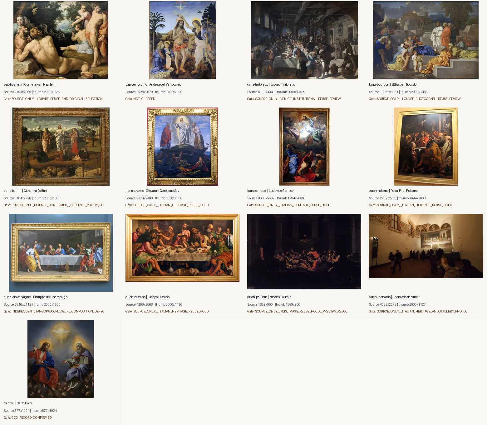

# Sacred Art V23 — 13 held owner-selected photographs

**Status:** research-only, not production-gallery published. Reviewed 17 November 2026.

This document supports the existing 31-artwork selected set. **No additional selection, payment, permission request, prayer placement, or gallery release** is authorized by this audit. The production main at the time of review has **873 catalogue records / 472 local photographs**. PR #21's existing 11 gallery proposals remain separate and unmerged.

## Contact sheet

This is a comparative *research sheet*, not a page for the public app. The full-resolution originals and WebP derivatives are retained under their earlier acquisition batches (V14, V15, V17 and V18); nothing is recompressed in the public gallery.

## Source-by-source audit (13/13)

Every photograph was compared with the known physical aspect ratio of its **exact museum artwork**. The difference is a diagnostic only; original canvas shapes, photography perspective and frames can all affect it.

| Owner selection ID | Source archive | Original pixels | Aspect deviation | Image gate | Reuse/identity group |
|---|---|---:|---:|---|---|
| `bap-haarlem` | [Original archive](./staged-selected31-v17/bap-haarlem-source.jpg) | 2494×2060 | 0.1% | Rights or source hold | FR LOUVRE INDEPENDENT PHOTOGRAPH |
| `bap-verrocchio` | [Original archive](./staged-selected31-v14/bap-verrocchio-source.jpg) | 2528×2970 | 0.2% | Rights or source hold | IT PUBLIC HERITAGE |
| `cana-tintoretto` | [Original archive](./staged-selected31-v18/cana-tintoretto-source.jpg) | 6119×4441 | 12.0% | **Inspect composition** | IT VENICE CHURCH HERITAGE |
| `king-bourdon` | [Original archive](./staged-selected31-v18/king-bourdon-source.jpg) | 10952×8131 | 10.4% | **Inspect composition** | FR LOUVRE INDEPENDENT PHOTOGRAPH |
| `trans-bellini` | [Original archive](./staged-selected31-v15/trans_bellini-source.jpg) | 3404×2728 | 6.8% | Rights or source hold | IT PUBLIC HERITAGE |
| `trans-savoldo` | [Original archive](./staged-selected31-v18/trans-savoldo-source.jpg) | 2276×2488 | 0.9% | Rights or source hold | IT PUBLIC HERITAGE |
| `trans-carracci` | [Original archive](./staged-selected31-v18/trans-carracci-source.jpg) | 3603×5567 | 5.9% | Rights or source hold | IT PUBLIC HERITAGE |
| `euch-rubens` | [Original archive](./staged-selected31-v17/euch-rubens-source.jpg) | 2232×2716 | 0.0% | Rights or source hold | IT PUBLIC HERITAGE |
| `euch-champaigne` | [Original archive](./staged-selected31-v15/euch_champaigne-source.jpg) | 2816×2112 | 28.4% | **Inspect composition** | FR LOUVRE INDEPENDENT PHOTOGRAPH  IMAGE GEOMETRY |
| `euch-bassano` | [Original archive](./staged-selected31-v17/euch-bassano-source.jpg) | 4296×2568 | 4.0% | Rights or source hold | IT PUBLIC HERITAGE |
| `euch-poussin` | [Original archive](./staged-selected31-v18/euch-poussin-source.jpg) | 1359×900 | 0.3% | Rights or source hold | UK NGS UNAVAILABLE IMAGE |
| `euch-leonardo` | [Original archive](./staged-selected31-v18/euch-leonardo-source.jpg) | 4032×2272 | 7.2% | Rights or source hold | IT PUBLIC HERITAGE |
| `tri-dolci` | [Original archive](./staged-selected31-v15/tri_dolci-source.jpg) | 877×1024 | 0.3% | Rights or source hold | US RISD PREVIEW QUALITY |

The three **geometry outliers** are `cana-tintoretto` (12.0%), `king-bourdon` (10.4%), `euch-champaigne` (28.4%). They must be inspected for frame, wall, perspective and actual canvas boundary before any gallery promotion.

## Priority decisions

**A — Haarlem — a stronger alternative located, but not acquired.** The original review selected Cornelis van Haarlem's **1588 Louvre RF 1983-25**, not his separate later Baptism (RF 1983-91). [Sailko's 3,312×2,736 independent CC BY 3.0 photograph](https://commons.wikimedia.org/wiki/File:Cornelis_van_haarlem,_battesimo_di_cristo,_1588,_02.JPG) is an exact subject match with a published source SHA-1. GitHub retrieval was blocked by Wikimedia HTTP 429; its downloaded binary and derivative do not exist in this batch. Retain Shonagon's PDM-marked photo in the archive. Do not publish a replacement without verifying actual bytes and attribution.

**B — French composition:** Louvre Bourdon INV 2806's 10.4% geometric mismatch makes a frame/perspective check necessary; Shonagon's PD-Art/PDM is a copyright *status claim*, not the same as an express own-work CC licence. The Champaigne INV 1125 Tangopaso photo is expressly dedicated to the public domain but photographs the picture on a blue gallery wall with an apparent cut-off left margin. It is not a clean reproduction suitable for the owner's full-composition prayer aesthetic. No unlicensed RMN image should replace it.

**C — Poussin 1647 second series — new alternative reference, not an asset.** [Artangel's exhibition page](https://www.artangel.org.uk/project/the-seven-sacraments-of-nicolas-poussin/paintings/) shows *Eucharist (1647)* and [a larger reproduction](https://media.artangel.org.uk/images/1997ssonp_painting6.width-2000.jpg). The site's public-domain statement concerns the painting itself, without clearly granting rights to the image. The [National Galleries of Scotland](https://www.nationalgalleries.org/art-and-artists/8668) say their image is restricted or not photographed. No copy of Artangel's image has been committed.

**D — RISD Carlo Dolci — licence resolved, quality unresolved.** The exact *Trinity in Glory*, RISD 59.009, is CC0 on Commons; the actual available file remains **877×1,024**, despite camera/scanner EXIF referring to a larger source. Do not upscale or claim a 4K original.

**E — Italian sources — eight separate heritage-reuse cases.** Verrocchio/Leonardo, Tintoretto, Bellini, Savoldo, Ludovico Carracci, Rubens at Brera, Bassano at Borghese and Leonardo's mural retain independent heritage-law review gates. A photographer's CC licence does not by itself settle the extra conditions of Italian public cultural-asset reuse for a commercial application. Relevant official evidence: [March 2024 Italian Ministry reproduction decree](https://asmo.cultura.gov.it/fileadmin/risorse/normativa/DM_21_marzo_2024_rep._108-signed.pdf). No permissions or fees requested.

## Reproducible evidence

- [Machine-readable 13-photo geometry and original hashes](./staged-selected31-v23/held-photo-audit.v23.json)
- [V23 alternative download result and HTTP failures](./staged-selected31-v23/acquisition-results.v23.json)
- [V23 decision register](./selected31-review-board-v23.json)
- [V23 updated 31-selected disposition register](./selected31-clearance-v23.json)
- [V23 hold resolution register](./selected31-held-remediation-v23.json)

**Scope boundaries:** original 873 records are unchanged; 11 draft candidates remain unmerged; 13 are still held; seven existing main images are preserved. No card-level painting assignments and no automatic online deployment.
