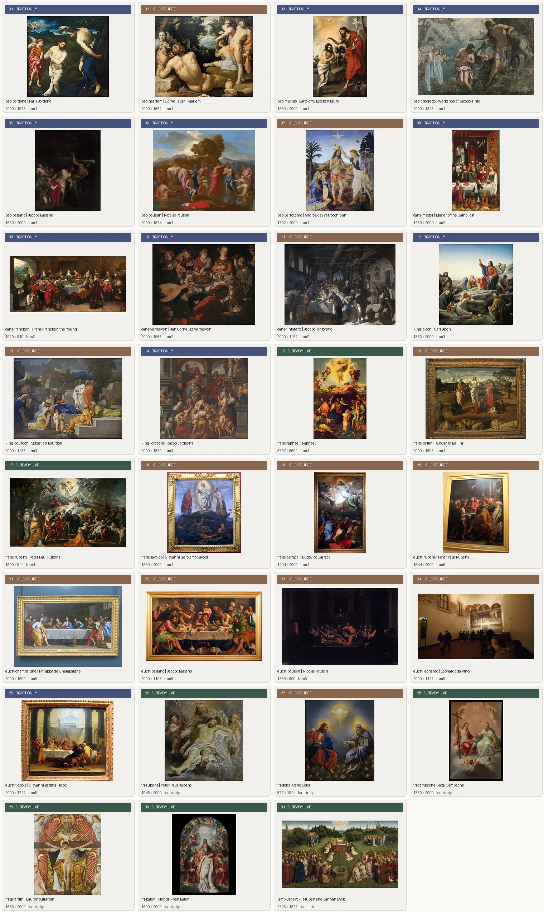
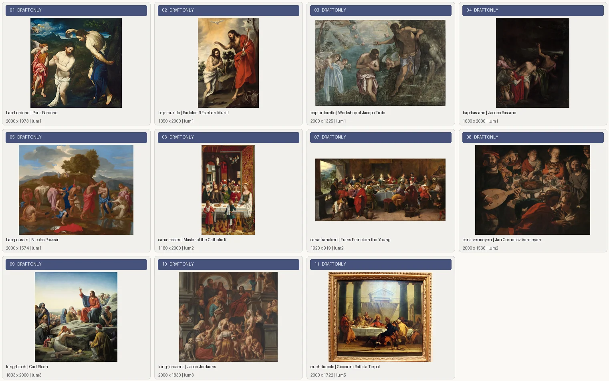

# Sacred Art V24 — Complete owner-selected artwork reconciliation

**Review date:** 17 November 2026

This dossier covers **all 31 original owner-selected paintings** in one comparative review. It does not expand the selected corpus, approve prayer-card placements, import held photographs into the public site, alter the canonical 873-record gallery, or merge PR #21.

## Thirty-one artworks — complete image matrix

The original selections are preserved in three groups:

| Category | Count | Meaning |
|---|---:|---|
| Already published in production | **7** | Existing image and work record preserved; never duplicate |
| Gallery-only candidates in draft PR #21 | **11** | Eleven actual image derivatives; not automatically prayer-approved |
| Held in source archive | **13** | Rights, independent photo provenance or suitable reproduction not sufficiently resolved |
| **Total** | **31** | Exact historical selection set |

### Eleven draft-gallery candidates

The photos and source hashes were read from the original 11 image files. They were **not synthesized, substituted or repainted**.

| Artwork ID | Attribution | Photo-rights evidence | Actual local pixels | Image |
|---|---|---|---:|---|
| `bap-bordone` | Paris Bordone | Institution open access | 2000 × 1973 | [Photo](../../site/gallery/images/selected31-bap-bordone-2000.webp) |
| `bap-murillo` | Bartolomé Esteban Murillo | Public Domain Mark; jurisdiction check | 1350 × 2000 | [Photo](../../site/gallery/images/selected31-v14-bap-murillo-2000.webp) |
| `bap-tintoretto` | Workshop of Jacopo Tintoretto | Institution open access | 2000 × 1325 | [Photo](../../site/gallery/images/selected31-bap-tintoretto-2000.webp) |
| `bap-bassano` | Jacopo Bassano | Institution open access | 1630 × 2000 | [Photo](../../site/gallery/images/selected31-bap-bassano-2000.webp) |
| `bap-poussin` | Nicolas Poussin | Institution open access | 2000 × 1574 | [Photo](../../site/gallery/images/selected31-bap-poussin-2000.webp) |
| `cana-master` | Master of the Catholic Kings | Institution open access | 1180 × 2000 | [Photo](../../site/gallery/images/selected31-cana-master-2000.webp) |
| `cana-francken` | Frans Francken the Younger | Public Domain Mark; jurisdiction check | 1920 × 919 | [Photo](../../site/gallery/images/selected31-v21-cana-francken-1920.webp) |
| `cana-vermeyen` | Jan Cornelisz Vermeyen | Official museum public-domain service | 2000 × 1566 | [Photo](../../site/gallery/images/selected31-v20-cana-vermeyen-2000.webp) |
| `king-bloch` | Carl Bloch | Public Domain Mark; jurisdiction check | 1833 × 2000 | [Photo](../../site/gallery/images/selected31-v14-king-bloch-2000.webp) |
| `king-jordaens` | Jacob Jordaens | Museum CC0 | 2000 × 1830 | [Photo](../../site/gallery/images/selected31-v22-king-jordaens-2000.webp) |
| `euch-tiepolo` | Giovanni Battista Tiepolo | Own-work CC BY 3.0 | 2000 × 1722 | [Photo](../../site/gallery/images/selected31-v22-euch-tiepolo-2000.webp) |

**Rights assessment:** Five original images come from directly reusable institutional open-access collections (NGA, Cleveland, Met). One is Rijksmuseum's official public-domain image service, one SMK CC0, and one an independently photographed Sailko CC BY 3.0 image with attribution and adaptation information. These eight have strong source-level photographic rights evidence, although all still require final visual and jurisdiction checks. The other three — Murillo, Bloch and Francken — are from files with Public Domain Mark claims and require jurisdiction-specific evaluation. A Public Domain Mark is not an unconditional photographer permission.

The full per-image licensing, provenance and decision gates are machine-readable in [V24 release decision register](./selected31-release-decision-v24.json).

### Thirteen held photographs — actions without fees or permissions

These are original selected works, not rejected paintings. Their existing photo bytes remain archived with SHA-256. Do not confuse a high-resolution file with rights clearance.

| Artwork ID | Outstanding gate | Evidence-based next action |
|---|---|---|
| `bap-haarlem` | FR LOUVRE INDEPENDENT PHOTOGRAPH | Avoid acquisition retry for framed Sailko 02 as preferred visual master; Shonagon original is cleaner. Resolve Commons original selected curid and faithful photo jurisdictional copyright only before gallery. |
| `bap-verrocchio` | IT PUBLIC HERITAGE | Keep archived source out of public gallery pending jurisdictional heritage-reuse decision. |
| `cana-tintoretto` | IT VENICE CHURCH HERITAGE | Check original arched/rectangular canvas geometry: 12.0% wider image than WGA physical ratio. Preserve Italian cultural-property rights hold for potential commercial use. |
| `king-bourdon` | FR LOUVRE INDEPENDENT PHOTOGRAPH | Preserve exact full-painting Shonagon photograph; no visually apparent frame/crop. Clarify PDM reuse and 10.4% geometric mismatch if required. Do not substitute Chicago or Sothebys works. |
| `trans-bellini` | IT PUBLIC HERITAGE | Keep archived source out of public gallery pending jurisdictional heritage-reuse decision. |
| `trans-savoldo` | IT PUBLIC HERITAGE | Keep archived source out of public gallery pending jurisdictional heritage-reuse decision. |
| `trans-carracci` | IT PUBLIC HERITAGE | Keep archived source out of public gallery pending jurisdictional heritage-reuse decision. |
| `euch-rubens` | IT PUBLIC HERITAGE | Keep archived source out of public gallery pending jurisdictional heritage-reuse decision. |
| `euch-champaigne` | FR LOUVRE INDEPENDENT PHOTOGRAPH  IMAGE GEOMETRY | Prefer exact full painting with independent photographer license; low-res Google-derived PDM Commons reference is not automatically safer than Tangopaso's PD-self cropped photo. |
| `euch-bassano` | IT PUBLIC HERITAGE | Keep archived source out of public gallery pending jurisdictional heritage-reuse decision. |
| `euch-poussin` | UK NGS UNAVAILABLE IMAGE | Artangel serves an approx 2000px image of exact 1647 second-series Eucharist, but its public-domain commentary concerns original art; Artangel footer reserves rights and Scottish collection still limits source image. Do not mirror/download until image licence is independently supported. |
| `euch-leonardo` | IT PUBLIC HERITAGE | Keep archived source out of public gallery pending jurisdictional heritage-reuse decision. |
| `tri-dolci` | US RISD PREVIEW QUALITY | RISD official public API blocked with HTTP 403, so larger source is not disproven; continue source hunt without contacting rights holder or paying. Preserve existing CC0 877px true original. |

#### Four source decisions resolved in this batch

**Cornelis van Haarlem — *The Baptism of Christ*, Louvre RF 1983-25.** The Sailko CC BY 3.0 alternative (3,312 × 2,736) was checked visually. It includes a large ornamental gilt frame around the painting; the original 2,494 × 2,060 Shonagon file has a much tighter painted composition and remains the preferred visual source. Neither the photographer licence nor its inclusion in Commons settles jurisdictional PD-Art questions for the Shonagon file. **No image replacement.** [Sailko own photograph](https://commons.wikimedia.org/wiki/File:Cornelis_van_haarlem,_battesimo_di_cristo,_1588,_02.JPG) · [Shonagon original](https://commons.wikimedia.org/wiki/File:Le_Bapt%C3%AAme_du_Christ_-_Cornelis_Cornelisz_van_Haarlem_-_Mus%C3%A9e_du_Louvre_-_Peintures_RF_1983-25.jpg) · [Louvre object](https://collections.louvre.fr/en/ark:/53355/cl010064767).

**Sébastien Bourdon — *Christ Blessing the Children*, Louvre INV 2806.** The exact archival Shonagon source is a high-resolution photograph of the composition without a visible ornate frame. Its aspect ratio differs 10.4% from the museum's reported painting dimensions; this deserves scrutiny but does not by itself establish that any part of the painting was lost. It is **not** the similarly titled Sotheby's or Chicago variant. **Composition hold narrowed; photo-rights hold remains.** [Commons source](https://commons.wikimedia.org/wiki/File:Le_Christ_et_les_enfants_-_S%C3%A9bastien_Bourdon_-_Mus%C3%A9e_du_Louvre_Peintures_INV_2806_%3B_MR_1256.jpg) · [Louvre object](https://collections.louvre.fr/en/ark:/53355/cl010059179).

**Philippe de Champaigne — *La Petite Cène*, Louvre INV 1125.** Tangopaso's own self-public-domain photograph is 2,816 × 2,112 but the left-hand painting appears clipped. A separate Commons file, *Champaigne Petite Cène Louvre.jpg*, shows a complete painting at 1,112 × 591, but cites only “Google” as its source and uses PD-Art rather than a verified own-photo licence. Do not replace a stronger-source photograph with a legally uncertain lower-resolution version. **Hold remains.** [Complete lower-res reference](https://commons.wikimedia.org/wiki/File:Champaigne_Petite_C%C3%A8ne_Louvre.jpg) · [Louvre object](https://collections.louvre.fr/ark:/53355/cl010062076).

**Carlo Dolci — *The Trinity in Glory*, RISD Museum 59.009.** The public photo is CC0, but the original available Commons image really is only 877 × 1,024 pixels. RISD's no-key public Collection API was checked twice on a GitHub runner; both requests returned **HTTP 403**, which does **not** mean the museum has no higher-resolution photograph. No legal permission request, contact or fee was made. **Hold remains.** [Official public-domain image policy](https://risdmuseum.org/image-request-form) · [V24 API probe](./staged-selected31-v24/risd-dolci-probe.v24.json).

## Baseline and deployment boundary

Production is **873 searchable catalogue records and 472 locally hosted painting files**, at main commit `df809f2357999dfa1a2e19ede15067472a779a82`. The unchanged PR #21 proposal would be **883 gallery records / 483 images**, including Bloch's image added to one existing catalogue record. None of these 11 proposed image associations is a new prayer-card approval.

All temporary GitHub Actions used for research must be removed after QA. GitHub Actions plus GitHub Pages remains the only deployment path. **Do not merge PR #21 or publish the held sources without explicit owner authorization.**

## Reproducible files

- [All 31 image source dimensions and SHA-256 hashes](./staged-selected31-v24/selected31-all-visual-source-matrix.v24.json)
- [V24 31 selection clearance](./selected31-clearance-v24.json)
- [V24 11-candidate photographic rights decision](./selected31-release-decision-v24.json)
- [V24 13-source remaining hold ledger](./selected31-held-remediation-v24.json)
- [V24 RISD official API source probe](./staged-selected31-v24/risd-dolci-probe.v24.json)
- [V23 13-held-source geometry/contact-sheet audit](./selected31-v23-held-photo-review.md)

**Final rule:** the same artwork may legitimately appear in several Rosary or prayer contexts, but its appearance in the permanent research or gallery registry does not authorize any new cinematic or prayer-card assignment.
