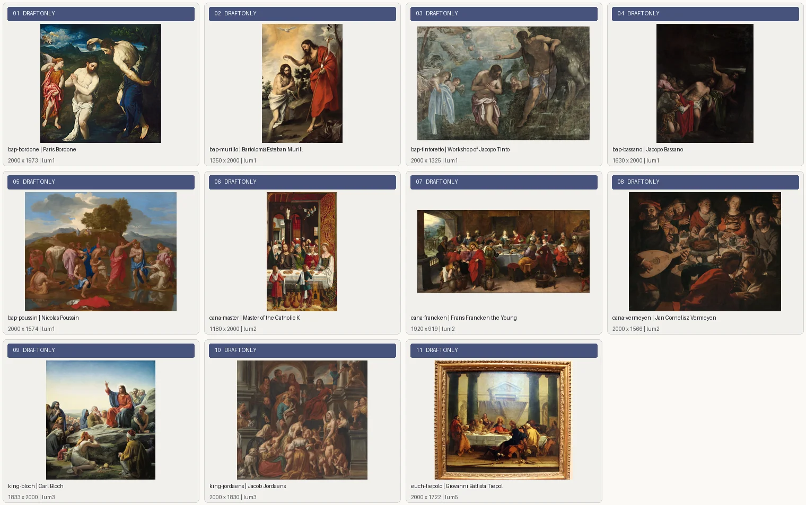

# Sacred Art V25 — Ten-image conditional release package

**17 November 2026 · Draft review only · No public gallery change or owner release authorization**

The original selected corpus remains **31 works**: seven are already represented in production, eleven photo attachments are staged in PR #21, and thirteen sources are archived on hold. V25 adds **no painting, no photograph and no prayer-card assignment**. Instead, it separates the eleven staged candidates into ten with strong source-level reuse evidence and one unresolved Frederiksborg reproduction.

This review supplements the [complete 31-image V24 picture-led dossier](./selected31-v24-all-artwork-review.md). It does not supersede the original artwork-selection decisions.

## Ten source-supported candidate photographs

The following ten photographs have exact artwork identities, local SHA-256-verified image files and an explicit photographer licence or primary museum reuse policy. They are **not** legally certified worldwide or automatically approved for visual presentation or prayer screens.

| Selected ID | Artwork | Source-level reuse support | Current image pixels | Photograph |
|---|---|---|---:|---|
| `bap-bordone` | Paris Bordone — *The Baptism of Christ* | Museum Open Access | 2000 × 1973 | [Review photo](../../site/gallery/images/selected31-bap-bordone-2000.webp) |
| `bap-murillo` | Bartolomé Esteban Murillo — *The Baptism of Christ* | Museum PDM + explicit commercial reuse | 1350 × 2000 | [Review photo](../../site/gallery/images/selected31-v14-bap-murillo-2000.webp) |
| `bap-tintoretto` | Workshop of Jacopo Tintoretto — *Baptism of Christ* | Museum Open Access | 2000 × 1325 | [Review photo](../../site/gallery/images/selected31-bap-tintoretto-2000.webp) |
| `bap-bassano` | Jacopo Bassano — *The Baptism of Christ* | Museum Open Access | 1630 × 2000 | [Review photo](../../site/gallery/images/selected31-bap-bassano-2000.webp) |
| `bap-poussin` | Nicolas Poussin — *The Baptism of Christ* | Museum Open Access | 2000 × 1574 | [Review photo](../../site/gallery/images/selected31-bap-poussin-2000.webp) |
| `cana-master` | Master of the Catholic Kings — *The Marriage at Cana* | Museum Open Access | 1180 × 2000 | [Review photo](../../site/gallery/images/selected31-cana-master-2000.webp) |
| `cana-francken` | Frans Francken the Younger — *The Wedding at Cana* | Museum PDM + explicit commercial reuse | 1920 × 919 | [Review photo](../../site/gallery/images/selected31-v21-cana-francken-1920.webp) |
| `cana-vermeyen` | Jan Cornelisz Vermeyen — *The Marriage at Cana* | Official museum public-domain photo | 2000 × 1566 | [Review photo](../../site/gallery/images/selected31-v20-cana-vermeyen-2000.webp) |
| `king-jordaens` | Jacob Jordaens — *Christ Blessing the Children* | Museum CC0 | 2000 × 1830 | [Review photo](../../site/gallery/images/selected31-v22-king-jordaens-2000.webp) |
| `euch-tiepolo` | Giovanni Battista Tiepolo — *The Last Supper* | Photographer CC BY 3.0 | 2000 × 1722 | [Review photo](../../site/gallery/images/selected31-v22-euch-tiepolo-2000.webp) |

### Two newly established institutional releases

**Murillo, *Baptism of Christ*, SMB object 868725, inv. 68.2.** The exact museum object page credits the Gemäldegalerie and Jörg P. Anders, marking its image Public Domain Mark 1.0. [SMB's Open Science Terms](https://www.smb.museum/en/open-science/use/) explicitly permit public-domain object illustrations to be copied, adapted, redistributed and used for commercial purposes. This object image is separate from temporary exhibition **press** images governed by other conditions.

**Francken the Younger, *Wedding at Cana*, Nationalmuseum NM 7504.** The exact Nationalmuseum-origin 1920×919 Commons file is PDM-marked (original SHA-1 `e0e1011ae234d7dbfced32f6eacd544392a87541`). [Nationalmuseum's reuse policy](https://www.nationalmuseum.se/en/explore-art-and-design/images/rights-and-reproductions) and [its Commons image guidance](https://www.nationalmuseum.se/en/explore-art-and-design/images/order-images-rights) expressly permit reuse of the institution's public-domain reproductions, including commercial reuse. The same museum object has **other, different photographs marked CC BY-SA**; do not silently substitute one of them. The exact-file credit includes artwork and Nationalmuseum; individual photographer attribution should not be invented.

### Eleventh staged photo — still a conditional source

**Carl Bloch, *Sermon on the Mount* (1877).** The production-staged 1833×2000 WebP is derived from a genuinely high-resolution **6599×7200** original, previously archived from [a Commons file uploaded 10 November 2026](https://commons.wikimedia.org/wiki/File:Carl_Bloch_-_The_Sermon_on_the_Mount.jpg), citing Frederiksborg Museum Photo Service. The [museum's photo service](https://frederiksborg.dk/en/photo-service) offers photographs free to businesses but requires a delivery/order process and may charge administration fees or for new shots. The institution's [downloadable press photos](https://frederiksborg.dk/fotos-til-download/) have stricter storage/cropping terms and are a separate source. **Neither policy alone constitutes an explicit unrestricted licence for this exact existing Commons copy** in every jurisdiction. Keep the original photo and current draft image, but **do not include the Bloch image patch in a ten-image release** until this distinction is resolved without a fee, contact or permission request.

## Two possible release configurations — neither authorized yet

| Feature | Ten-image source-supported subset | All eleven current PR #21 images |
|---|---:|---:|
| Current production gallery records | 873 | 873 |
| Current locally hosted paintings | 472 | 472 |
| Additional searchable artwork records | +10 | +10 |
| Additional painting files | **+10** | **+11** |
| Projected gallery records if approved | **883** | **883** |
| Projected hosted painting files if approved | **482** | **483** |
| Bloch existing-record image patch | Excluded | Included, still conditional |
| Automatic Rosary/prayer-card assignments | 0 | 0 |
| Owner authorization to merge | **Not received** | **Not received** |

The *current draft PR #21 still contains all eleven photos*. The ten-image subset is a **precise conditional release manifest**, not a change to the production site or a silent partial merge. It identifies exactly which candidate could be excluded later without changing the ten accepted artwork identities.

## International reuse caution

The [Mauritius Copyright Act 2014](https://lawsofmauritius.govmu.org/portal/viewlegislationdocument/web/?docnumber=QWN0IDEgb2YgMjAxNA%3D%3D&doctitle=&doctype=act) requires original intellectual creation and defines an original work as distinct from an essentially copied work. This supports a distinction between faithful mechanical reproductions and independently creative photographs, but does **not** automatically settle all international photo or cultural-heritage claims.

The [French INHA guide](https://www.inha.fr/app/uploads/2024/11/2021_LIVRET_GUIDE-PRATIQUE_web_15062021.pdf) likewise distinguishes faithful two-dimensional reproductions from creative photographs. The eight Italian cultural-heritage source holds stay isolated: a photographer's CC licence is not a substitute for any applicable rules governing commercial reproduction of protected public cultural assets.

## Reproducible decisions

- [Machine-readable eleven-photo licence evidence, 10/1 classifications](./selected31-release-decision-v25.json)
- [Ten-image exact source-hash release gate and unresolved Bloch patch](./selected31-release-gate-v25.json)
- [All original 31 photo fingerprints](./staged-selected31-v24/selected31-all-visual-source-matrix.v24.json)
- [Thirteen-source archive and restrictions](./selected31-held-remediation-v24.json)
- [Existing fully staged but unmerged proposal PR #21](https://github.com/Fulcanelli13/ad-orientem-production/pull/21)

**Nothing is published by this review. No new selected painting, payment, rights-holder contact, changes to prayer scenes or mass-cards, or automation deployment is authorized.**
