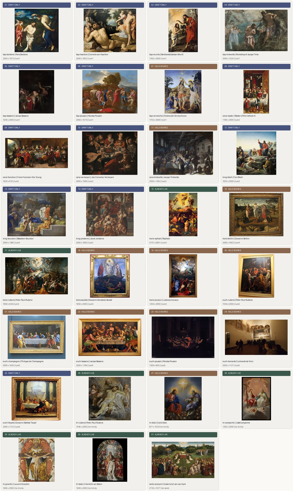
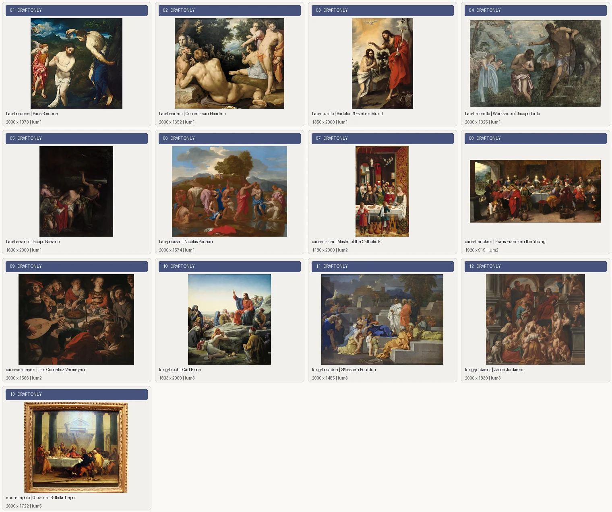
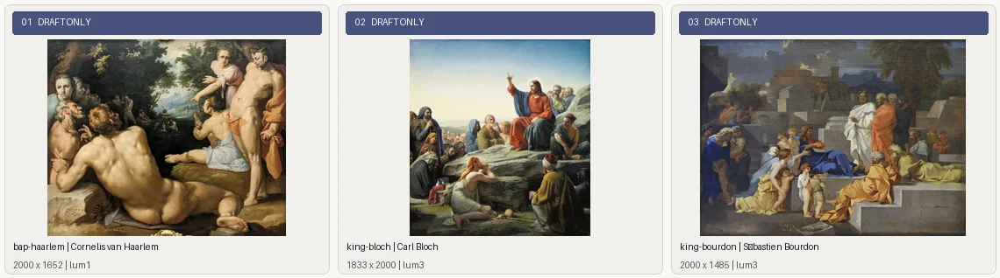

# Sacred Art V26 — Two exact Louvre works staged conditionally; 11 source holds remain

**17 November 2026 · PR #21 is draft-only, not merged or deployed**

This is the consolidated current status of the owner's **31 original selected artworks** after 26 source/photo review rounds. The canonical production gallery catalogue, owner selection identity, prayer-card artwork defaults and existing production images have **not** been modified. The two new local image files are SHA-256 identical to previously archived derivatives; this batch does **not** rely on a new internet download.

## Visual review of all 31 original artwork selections

| Disposition | Count | Status |
|---|---:|---|
| Already present in production | **7** | Existing original image/record preserved, never duplicated |
| Draft-gallery candidates | **13** | 10 with strong source reuse evidence, 3 conditional photographic cases |
| Source-only holds | **11** | 8 Italian cultural-asset cases, Champaigne, Poussin and Dolci |
| **Exact original selected works** | **31** | No added selections, no substitutions |

### Thirteen proposed draft-gallery images

The original 11 draft proposals from V25 are retained. **Two new records and two local image blobs** have been staged in `site/gallery/selected31-reviewed-images.v26.json`. Neither is a public production image or a new prayer-artwork default.

1. **Cornelis van Haarlem — *The Baptism of Christ* (1588), Louvre RF 1983-25.** The verified Shonagon own-photograph file was uploaded to Commons on **20 January 2022**, with an original **2,494 × 2,060** photograph and archived **2,000 × 1,652** WebP derivative. The object is exact and the painting aligns with museum dimensions (approximately 0.1% ratio difference). The original historical selected Commons `curid=75930307` is **not proven to identify this newer photo**; the photo is explicitly a verified **alternative image of the same owner-selected painting**, not a claim that it is the original selected file. The full frame was preferred over the larger Sailko photo, which includes an ornate gilt frame. Commons assigns PD-Art/PDM to the faithful photograph. **Conditional draft gallery candidate, not worldwide copyright-cleared.** [Exact Commons photograph](https://commons.wikimedia.org/wiki/File:Le_Bapt%C3%AAme_du_Christ_-_Cornelis_Cornelisz_van_Haarlem_-_Mus%C3%A9e_du_Louvre_-_Peintures_RF_1983-25.jpg) · [Louvre inventory](https://collections.louvre.fr/en/ark:/53355/cl010064767).
2. **Sébastien Bourdon — *Christ Blessing the Children*, Louvre INV 2806 / MR 1256.** Shonagon's own photograph, taken on **8 August 2025**, is an original **10,952 × 8,131** camera file, archived along with its **2,000 × 1,485** derivative. The exact Louvre inventory and work are verified; **not** the different Chicago or auction painting of the same subject. The photograph depicts the artwork without a prominent ornate frame. Its image proportion is about **10.4% wider** than the catalogued canvas dimensions, which remains a manual image-framing check rather than proof of clipping. Commons tags this personally uploaded faithful photograph PD-Art/PDM. **Conditional draft candidate with visual/copyright jurisdiction review; no automatic prayer use.** [Exact Commons photograph](https://commons.wikimedia.org/wiki/File:Le_Christ_et_les_enfants_-_S%C3%A9bastien_Bourdon_-_Mus%C3%A9e_du_Louvre_Peintures_INV_2806_%3B_MR_1256.jpg) · [Louvre inventory](https://collections.louvre.fr/en/ark:/53355/cl010059179).

### Three conditional photographs

The three are **Carl Bloch, Cornelis van Haarlem and Sébastien Bourdon**. Bloch's exact high-resolution museum Photo Service copy is PDM-marked but Frederiksborg's free photograph ordering service is not by itself an express reusable licence for that precise Commons copy. Haarlem's historic original source curid has not been linked to Shonagon's newer photo. Bourdon's source is verified independently but PD-Art status and its geometry are not universal legal/visual clearance.

PDM is a **status mark, not a photographer's express CC0 or CC BY licence**. [France's Ministry of Culture](https://www.culture.gouv.fr/thematiques/photographie/gerer-un-fonds-photographique/evaluation-patrimoniale/connaitre-l-environnement-juridique-d-un-fonds) states that photographic originality depends on independently creative choices and must be judged case by case; a faithful mechanical two-dimensional reproduction need not qualify as a separate copyright work. It does not automatically settle copyright in every jurisdiction or the conditions imposed on images actually downloaded from institutions. These are separately taken **Shonagon**, not Louvre/RMN official photography downloads.

## Eleven remaining holds — distinct structural blockers

| Source lane | Exact selected IDs | Number | Why not stage or publish now |
|---|---|---:|---|
| Italy public cultural heritage | `bap-verrocchio`, `trans-bellini`, `trans-savoldo`, `trans-carracci`, `euch-rubens`, `euch-bassano`, `euch-leonardo` | 7 | Photographer CC/PDM is not necessarily commercial-use permission for public heritage |
| Italian church-held heritage | `cana-tintoretto` | 1 | Venice Salute custody plus Italian heritage reuse, and 12% photo/canvas ratio variation |
| Independent French photo, image fidelity | `euch-champaigne` | 1 | Tangopaso photo public-domain self release, but painting's left edge appears cut; complete alternative lacks compelling photo provenance |
| Scotland high-res photo | `euch-poussin` | 1 | Exact **1647 second-series** National Galleries of Scotland *Eucharist* image restricted/unavailable; Artangel alt photo licence unresolved |
| US institutional image quality | `tri-dolci` | 1 | Exact RISD **59.009** source clearly CC0, but available true file only **877×1,024**; official API returned 403, not proof larger source is nonexistent |
| **Total** | | **11** | No fees, rights-holder contact, mismatched painting or artificial pixel enlargement |

The [official Italian digital heritage guidance](https://docs.italia.it/italia/icdp/icdp-pnd-circolazione-riuso-docs/it/v1.0-giugno-2022/acquisizione-circolazione-e-riuso-delle-riproduzioni-dei-beni-culturali-in-ambiente-digitale/tipologie-duso-delle-riproduzioni-di-beni-culturali.html) distinguishes freely reproducible noncommercial heritage dissemination from commercial licensing. This app may have a paid tier; assume no commercial heritage-exemption until a specific legal or institutional policy clearly establishes one. Do not begin paid licensing or owner-contact workflows.

## Production baseline and release gates

The live main branch remains at **873 canonical gallery records / 472 hosted painting images**. The current **draft-only** overlay has **12 additional records and 13 image attachments**, including one image patch to an existing Bloch record:

| | Current main | Ten-image supported subset | Full V26 draft (not approved) |
|---|---:|---:|---:|
| Gallery records | **873** | **883** | **885** |
| Hosted painting images | **472** | **482** | **485** |
| Conditional Bloch/Haarlem/Bourdon images added | 0 | 0 | **3** |
| Added prayer-card defaults | 0 | 0 | **0** |
| Owner release authorization | Not applicable | **Not received** | **Not received** |

The ten-source subset consists of the **five NGA/Met/Cleveland open-access photographs**, **one official Rijksmuseum public-domain image**, **one SMK CC0 photograph**, **one independent Sailko CC BY 3.0 photograph**, plus **the exact Murillo and Francken photographs supported by their institutions' explicit commercial/public-domain reuse policies**. No photograph licence here is certified for *every* jurisdiction.

**The current PR stages thirteen images, not just ten.** It is intentionally still a draft pending the owner's publication decision and final image QA. None of the three conditional-source cases will be silently included in the ten-source option.

## Verifiable evidence and code boundaries

- [Exact 31-artwork source/image hash matrix](./staged-selected31-v26/selected31-all-visual-source-matrix.v26.json)
- [V26 legal/source classification for 13 candidates](./selected31-release-decision-v26.json)
- [V26 explicit 10-vs-13 photo release options](./selected31-release-gate-v26.json)
- [V26 31-artwork status register](./selected31-clearance-v26.json)
- [V26 eleven held source registry](./selected31-held-remediation-v26.json)
- [V26 two conditional exact-photo gallery overlay](../../site/gallery/selected31-reviewed-images.v26.json)
- [Draft PR #21](https://github.com/Fulcanelli13/ad-orientem-production/pull/21)

The V26 loader accepts only exact review IDs, local image filenames and zero prayer-part associations. The historical 873-row catalogue, image provenance, the entire prayer activation registry and the production Pages deployment remain unchanged. The source and gallery additions do not authorize new prayer cinematics.

**This is a staged gallery research result, not an approval to merge or a licence opinion for every territory.**
